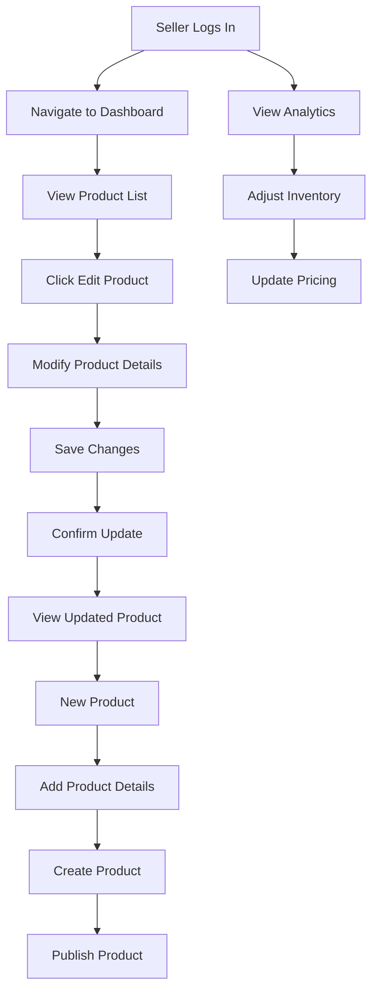
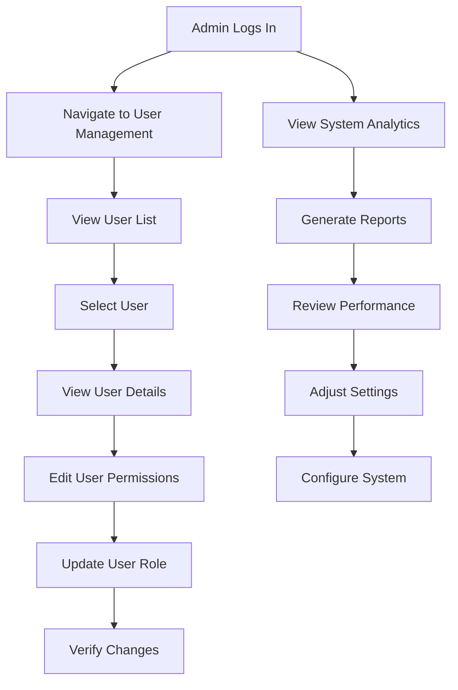

# Dashboard Design Specification

## Overview
This document defines the comprehensive dashboard design system for both Seller and Admin interfaces in the AfriTrade marketplace, establishing consistent layout patterns, visual hierarchy, and user interaction flows.

## Dashboard Architecture

### Dashboard Layout Hierarchy
```
DashboardShell (wrapper)
├── DashboardNav (role-specific navigation)
│   ├── Primary navigation items
│   ├── Secondary actions
│   └── User profile/account
├── Page Header (breadcrumb, title, metadata)
├── KPI Grid (statistical overview)
├── Main Content Area (role-specific interface)
└── Footer (system status, support info)
```

### Dashboard Variations

#### Seller Dashboard (`variant="paper"`)
**Theme**: Paper console theme for seller interface
**Purpose**: Seller-specific marketplace management
**Key Features**:
- Product management
- Inventory control
- Sales analytics
- Customer management

#### Admin Dashboard (`variant="default"`)
**Theme**: Standard admin interface
**Purpose**: System administration and user management
**Key Features**:
- User management
- System analytics
- Platform configuration
- Content moderation

### Dashboard Components Structure

#### Layout Components
| Component | Purpose | Role Usage |
|-----------|---------|------------|
| DashboardShell | Main container with consistent structure | Both |
| DashboardNav | Role-based navigation | Both |
| PageHeader | Page-specific information | Both |
| KPI Grid | Statistical overview | Both |
| MainContent | Role-specific interface | Both |

#### Role-Specific Components
| Component | Seller Use | Admin Use |
|-----------|------------|-----------|
| SellerProductCard | Core seller feature | Read-only view |
| SellerActions | Seller workflow | Admin review |
| SellerStats | Seller metrics | Admin monitoring |
| UserManagement | N/A | Admin core function |

## Visual Design System

### Paper Console Theme (`variant="paper"`)
```css
.dashboard-shell.variant-paper {
  background: linear-gradient(135deg, #667eea 0%, #764ba2 100%);
  backdrop-filter: blur(10px);
  border-radius: 24px;
  box-shadow: 0 20px 40px rgba(0, 0, 0, 0.1);
  padding: 2rem;
}
```

#### Theme Properties
- **Background**: Gradient with blur effect
- **Border Radius**: Large, rounded corners
- **Shadow**: Soft elevation with depth
- **Padding**: Generous spacing
- **Container**: Glass morphism effect

### DashboardNav Design

#### Navigation Structure
```css
.dashboard-nav {
  display: flex;
  flex-direction: column;
  gap: 0.5rem;
  background: rgba(255, 255, 255, 0.9);
  border-radius: 16px;
  padding: 1rem;
  box-shadow: 0 4px 12px rgba(0, 0, 0, 0.05);
}
```

#### Navigation Variants
**Seller Navigation**:
- **Primary Items**: Products, Inventory, Sales
- **Secondary Actions**: Add Product, Settings
- **Status Indicators**: Online/Offline status

**Admin Navigation**:
- **Primary Items**: Users, Analytics, Reports
- **Secondary Actions**: System Settings, Logs
- **System Status**: Platform health indicators

### Content Layout Patterns

#### Multi-Column Grid
```css
.content-grid {
  display: grid;
  grid-template-columns: repeat(auto-fit, minmax(280px, 1fr));
  gap: 1.5rem;
}

@media (min-width: 1024px) {
  .content-grid {
    grid-template-columns: repeat(auto-fit, minmax(320px, 1fr));
    gap: 2rem;
  }
}
```

#### Card-Based Layout
```css
.card {
  background: white;
  border-radius: 16px;
  box-shadow: 0 2px 8px rgba(0, 0, 0, 0.1);
  padding: 1.5rem;
  transition: all 0.3s ease;
}

.card:hover {
  transform: translateY(-2px);
  box-shadow: 0 8px 24px rgba(0, 0, 0, 0.15);
}
```

## User Interface Patterns

### Primary Action Patterns
```jsx
// Seller Dashboard Actions
<SellerActions
  primaryAction={primaryCTA}
  secondaryActions={secondaryCTAs}
  status={sellerStatus}
/>

// Admin Dashboard Actions
<AdminActions
  bulkActions={bulkOperations}
  filters={availableFilters}
  search={searchConfig}
/>
```

### Information Hierarchy
```css
/* Visual hierarchy with typography scale */
.hierarchy-title {
  font-size: 2rem;
  font-weight: 700;
  color: var(--color-text-primary);
  margin-bottom: 0.5rem;
}

.hierarchy-subtitle {
  font-size: 1.25rem;
  font-weight: 600;
  color: var(--color-text-secondary);
  margin-bottom: 1.5rem;
}

.hierarchy-meta {
  font-size: 0.875rem;
  color: var(--color-text-tertiary);
}
```

### State Management Visuals
```css
/* Loading states */
.skeleton {
  background: linear-gradient(90deg, #f0f0f0 25%, #e0e0e0 50%, #f0f0f0 75%);
  background-size: 200% 100%;
  animation: loading 1.5s infinite;
}

@keyframes loading {
  0% { background-position: 200% 0; }
  100% { background-position: -200% 0; }
}

/* Status indicators */
.status-indicator {
  display: inline-flex;
  align-items: center;
  gap: 0.5rem;
  padding: 0.25rem 0.75rem;
  border-radius: 20px;
  font-size: 0.875rem;
}

.status-indicator.online {
  background: var(--color-success-50);
  color: var(--color-success-700);
}

.status-indicator.offline {
  background: var(--color-error-50);
  color: var(--color-error-700);
}
```

## Component Specifications

### DashboardShell Component
```jsx
interface DashboardShellProps {
  nav: NavItem[];
  title?: string;
  children: React.ReactNode;
  className?: string;
  variant?: 'default' | 'paper';
}

export default function DashboardShell({
  nav,
  title,
  children,
  className,
  variant = 'default',
}: DashboardShellProps) {
  return (
    <div className={`dashboard-shell ${variant === 'paper' ? 'paper-console' : ''}`}>}
      <DashboardNav nav={nav} variant={variant} title={title} />
      <div className="page-content">{children}</div>
    </div>
  );
}
```

### DashboardNav Component
```jsx
interface DashboardNavProps {
  nav: NavItem[];
  variant?: 'default' | 'paper';
  title?: string;
}

export default function DashboardNav({
  nav,
  variant = 'default',
  title,
}: DashboardNavProps) {
  return (
    <nav className="dashboard-nav" role="navigation">
      {title && <h2 className="nav-title">{title}</h2>}
      <ul className="nav-list">
        {nav.map((item) => (
          <NavItem
            key={item.id}
            {...item}
            variant={variant}
          />
        ))}
      </ul>
    </nav>
  );
}
```

### SellerProductCard Component
```jsx
interface SellerProductCardProps {
  product: Product;
  onEdit: (product: Product) => void;
  onToggle: (product: Product) => void;
  onRemove: (product: Product) => void;
  ariaEdit?: string;
  ariaToggle?: string;
  ariaDelete?: string;
}

export default function SellerProductCard({
  product,
  onEdit,
  onToggle,
  onRemove,
  ariaEdit,
  ariaToggle,
  ariaDelete,
}: SellerProductCardProps) {
  return (
    <div className="seller-product-card">
      <div className="product-image">
        <Image src={product.images?.[0]} alt={product.title} />
      </div>
      <div className="product-info">
        <h3 className="product-title">{product.title}</h3>
        <p className="product-price">${product.price_usd}</p>
        <p className="product-stock">Stock: {product.stock}</p>
        <StatusBadge status={product.status} />
      </div>
      <div className="product-actions">
        <button
          onClick={() => onEdit(product)}
          aria-label={ariaEdit || 'Edit'}
        >
          <Pencil className="h-4 w-4" />
        </button>
        <button
          onClick={() => onToggle(product)}
          aria-label={ariaToggle || 'Publish / archive'}
        >
          {product.status === 'published' ? <EyeOff /> : <Eye />}
        </button>
        <button
          onClick={() => onRemove(product)}
          aria-label={ariaDelete || 'Delete'}
        >
          <Trash2 className="h-4 w-4" />
        </button>
      </div>
    </div>
  );
}
```

## User Flow Specifications

### Seller Workflow


### Admin Workflow


## Accessibility Specifications

### ARIA Requirements
```jsx
// DashboardShell ARIA
<div role="main" aria-label="Dashboard">
  <nav aria-label="Primary navigation">
    <DashboardNav />
  </nav>
</div>

// SellerProductCard ARIA
<div role="article" aria-labelledby="product-title">
  <h3 id="product-title">{product.title}</h3>
  <button aria-label="Edit product details">
    <Pencil />
  </button>
</div>
```

### Keyboard Navigation
```css
/* Focus indicators */
:focus-visible {
  outline: 2px solid var(--color-primary-500);
  outline-offset: 2px;
  box-shadow: 0 0 0 4px rgba(59, 130, 246, 0.1);
}

/* Skip navigation */
.skip-link {
  position: absolute;
  top: -40px;
  left: 6px;
  background: var(--color-primary-500);
  color: white;
  padding: 8px 16px;
  text-decoration: none;
  border-radius: 4px;
}

.skip-link:focus {
  top: 6px;
}
```

## Responsive Design Specifications

### Breakpoint Definitions
```css
breakpoints: {
  'mobile': '320px',
  'tablet': '768px', 
  'desktop': '1024px',
  'wide': '1280px'
}
```

### Responsive Dashboard Layout
```css
.dashboard-container {
  /* Mobile: 1 column */
  grid-template-columns: 1fr;
}

@media (min-width: 768px) {
  /* Tablet: 2 columns */
  .dashboard-container {
    grid-template-columns: repeat(2, 1fr);
  }
  
  .dashboard-nav {
    flex-direction: row;
  }
}

@media (min-width: 1024px) {
  /* Desktop: 3 columns */
  .dashboard-container {
    grid-template-columns: repeat(3, 1fr);
  }
}
```

## Performance Specifications

### Animation Guidelines
```css
/* Smooth animations */
* {
  transition-property: background-color, border-color, color, fill, stroke;
  transition-timing-function: cubic-bezier(0.4, 0, 0.2, 1);
  transition-duration: 150ms;
}

/* Reduced motion support */
@media (prefers-reduced-motion: reduce) {
  * {
    animation-duration: 0.01ms !important;
    animation-iteration-count: 1 !important;
    transition-duration: 0.01ms !important;
    scroll-behavior: auto !important;
  }
}
```

### Loading States
```jsx
// Skeleton loading for dashboard
const DashboardSkeleton = () => (
  <div className="dashboard-skeleton">
    <div className="skeleton-nav" />
    <div className="skeleton-content">
      {Array.from({ length: 6 }).map((_, index) => (
        <div key={index} className="skeleton-card" />
      ))}
    </div>
  </div>
);
```

## Testing Specifications

### Visual Regression Testing
```jsx
// Storybook examples for dashboard components
export const SellerDashboard = Template.bind({});
SellerDashboard.args = {
  variant: 'paper',
  title: 'Seller Dashboard',
  nav: sellerNavItems,
};

export const AdminDashboard = Template.bind({});
AdminDashboard.args = {
  variant: 'default',
  title: 'Admin Dashboard',
  nav: adminNavItems,
};
```

### Accessibility Testing
```jsx
// axe accessibility testing
it('should be accessible', async () => {
  const { container } = render(<DashboardShell />);
  await expectAxeToBeAccessible(container);
});
```

## Documentation Structure

### Dashboard Documentation Sections
1. **Overview**: Dashboard architecture and patterns
2. **Design System**: Paper console theme and visual specifications
3. **Component Specifications**: Detailed component documentation
4. **User Flows**: Role-specific workflows
5. **Accessibility**: WCAG compliance and ARIA requirements
6. **Responsive Design**: Breakpoint and layout specifications
7. **Performance**: Optimization and loading guidelines
8. **Testing**: Visual and accessibility testing

### Related Documentation
- **DESIGN_SYSTEM.md**: Core design system principles
- **BRAND_IDENTITY.md**: Brand application guidelines
- **TYPOGRAPHY_SYSTEM.md**: Typography specifications
- **COMPONENT_LIBRARY.md**: Component inventory
- **MOBILE_DESIGN_SPEC.md**: Mobile-specific dashboard patterns

---

*This Dashboard Design Specification provides comprehensive guidelines for designing consistent, accessible, and performant dashboard interfaces across both Seller and Admin roles in the AfriTrade marketplace.*